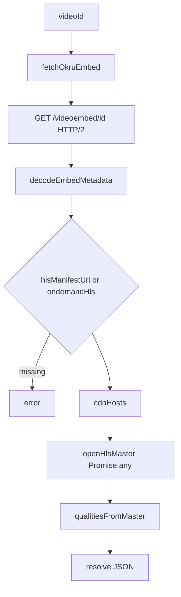
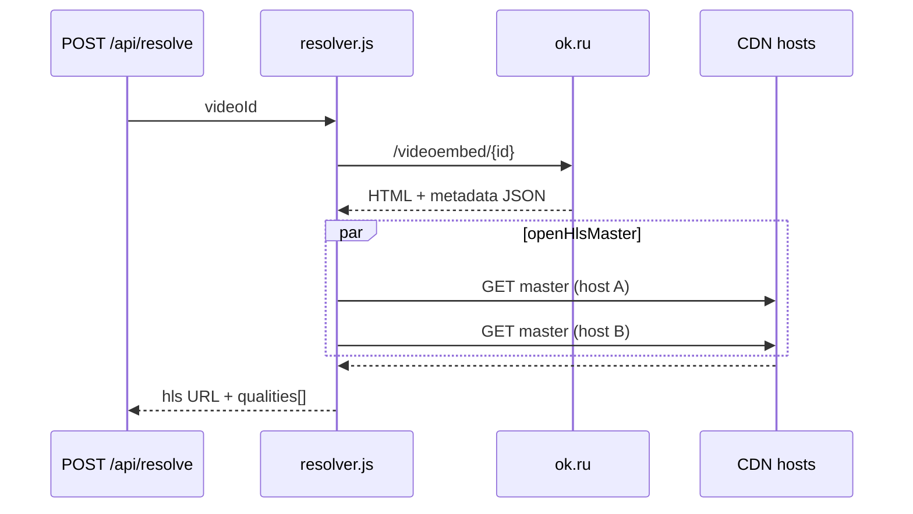
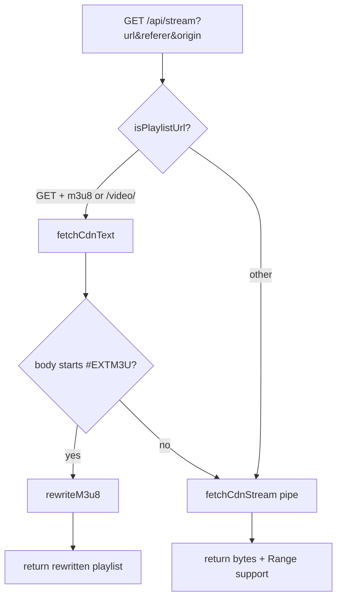
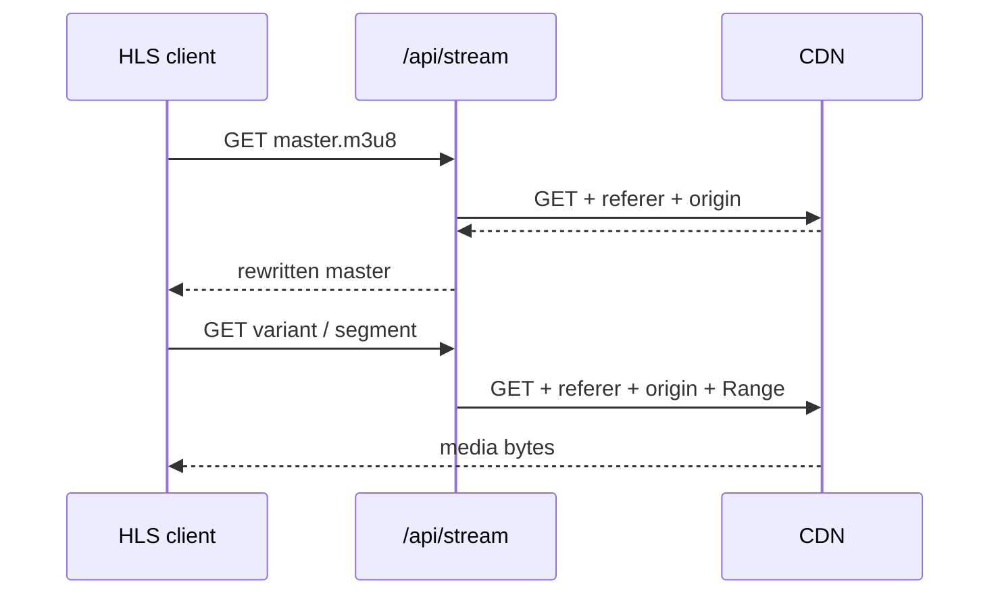

# ok.ru-direct-resolver

Resolves an ok.ru `videoId` to HLS variant URLs by reading embed metadata and the CDN master playlist. Playback goes through a local proxy that forwards CDN requests with required headers and rewrites `m3u8` URIs.

```bash
npm start    # http://localhost:8787 — PORT env overrides default
```

No npm `dependencies`. A small UI in `public/` calls the API; the resolver and stream proxy are the core.

---

## Resolver logic



### Step 1 — Embed fetch (`http/client.js`)

`fetchOkruEmbed(videoId)` opens an HTTP/2 connection to `https://ok.ru` and requests:

```
GET /videoembed/{videoId}
```

with `documentHeaders()` (Chrome 131 user-agent and sec-fetch headers from `browser-headers.js`).

### Step 2 — Metadata decode (`embed.js`)

Embed HTML contains escaped JSON after the marker:

```
&quot;metadata&quot;:&quot;
```

`decodeEmbedMetadata`:

1. Slice up to 25 000 chars after the marker.
2. Unescape `&quot;`, `&amp;`, `\\`.
3. Brace-balance from the first `{` and `JSON.parse`.

Master playlist URL (`hlsMasterUrl`):

```js
meta.hlsManifestUrl ?? meta.ondemandHls
```

If both are absent → `No HLS manifest in player metadata`.

### Step 3 — CDN host list (`cdnHosts`)

Hostnames collected from:

| Source | Field |
| --- | --- |
| Video entries | `meta.videos[].url` |
| Master URL | `hlsManifestUrl` or `ondemandHls` |
| Mirrors | `meta.failoverHosts[]` |

Deduplicated, sorted by `hostRank`:

| Rank | Rule |
| --- | --- |
| 0 | `*.okcdn.ru` |
| 1 | other hosts |
| 2 | `*vkuser.net*` |

### Step 4 — Master open (`openHlsMaster` in `hls.js`)

For each host, swap only the hostname on the master URL (`withHost`), then `GET` with:

```
referer: https://ok.ru/
origin:  https://ok.ru
timeout: 4000 ms
```

All hosts are fetched in parallel via `Promise.any`. Winner must be:

- HTTP `200`
- body starts with `#EXTM3U`

Returned `master.url` is the URL that succeeded (hostname may differ from the one in metadata).

### Step 5 — Quality extraction (`qualitiesFromMaster`)

Scans master playlist lines. For each `#EXT-X-STREAM-INF:`:

| Output | Parsed from |
| --- | --- |
| `quality` | `QUALITY=` attribute |
| `width`, `height` | `RESOLUTION=` (`WxH`) |
| `bandwidth` | `BANDWIDTH=` attribute |
| `url` | next line URI, resolved against `master.url` |
| `label` | `RESOLUTION` with `x` → `×`, else `quality` |

Sorted by `bandwidth` descending. Empty list → `No qualities in HLS master`.

### Resolve output (`resolver.js`)

| Field | Value |
| --- | --- |
| `videoId` | input |
| `title` | `meta.movie.title` |
| `hls` | winning `master.url` |
| `referer` | `https://ok.ru/` |
| `origin` | `https://ok.ru` |
| `qualities` | parsed variant list |
| `durationSec` | `meta.movie.duration` |
| `width`, `height` | top quality, fallback `meta.movie` |



---

## Playback logic

CDN URLs require `referer` and `origin` on every request (`OKRU_REFERER`, `OKRU_ORIGIN` in `constants.js`). Clients call `/api/stream` instead of the CDN directly.



### Playlist rewrite (`rewriteM3u8`)

For each non-comment, non-empty line in the playlist body:

1. Resolve line to absolute URL against the source manifest URL.
2. Replace with `/api/stream?url=…&referer=…&origin=…`.

hls.js (or any HLS client) following rewritten URIs stays on the proxy for variants and segments.

### Stream handler (`routes/stream.js`)

| Input | Behavior |
| --- | --- |
| `url`, `referer` | required query params |
| `origin` | optional; defaults to `https://ok.ru` |
| `Range` request header | forwarded to CDN |
| `HEAD` | CDN probe with `bytes=0-0` |

Playlist detection: URL matches `\.m3u8` **or** `/video/` path pattern.

Non-playlist responses stream through `fetchCdnStream` (8 s timeout) with `Content-Type`, `Accept-Ranges`, `Content-Range`, `Content-Length` passed through when present.



### Quality switching

Resolve returns one `url` per variant (variant playlist on CDN). Switching quality means using a different `qualities[n].url` as the stream entry, or — when using hls.js on the master — setting `currentLevel` to the level whose `width`/`height` or `name` matches `qualities[n]`.

---

## API

### `POST /api/resolve`

```http
Content-Type: application/json

{ "videoId": "12226347272789" }
```

`videoId` accepts 8+ digits or a URL matching `/(?:\/video\/|^)(\d{8,})/` (`parse-video-id.js`).

### `GET /api/stream`

```
/api/stream?url=<cdn-url>&referer=https://ok.ru/&origin=https://ok.ru
```

Supports `GET`, `HEAD`. Forwards `Range`.

---

## Source map

```
src/server/okru/
  embed.js      metadata decode, hlsMasterUrl, cdnHosts
  hls.js        openHlsMaster, qualitiesFromMaster, rewriteM3u8
  resolver.js   resolveVideo orchestration
  constants.js  OKRU_ORIGIN, OKRU_REFERER, timeouts
src/server/http/
  client.js     fetchOkruEmbed, fetchCdnText, fetchCdnStream
  browser-headers.js
src/server/routes/
  resolve.js    POST handler
  stream.js     proxy handler
```

---

## Disclaimer

**Educational and research purposes only.**

This project reads publicly served embed pages and HLS manifests. You are responsible for compliance with ok.ru terms, copyright, and applicable law.
